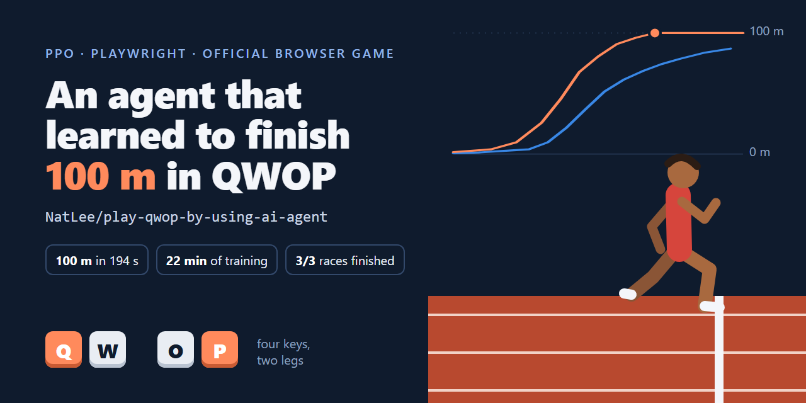
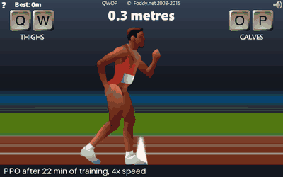
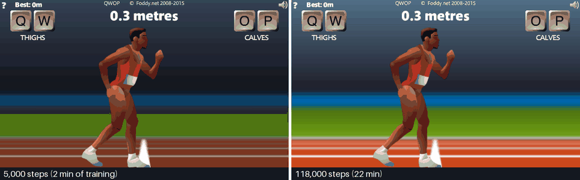
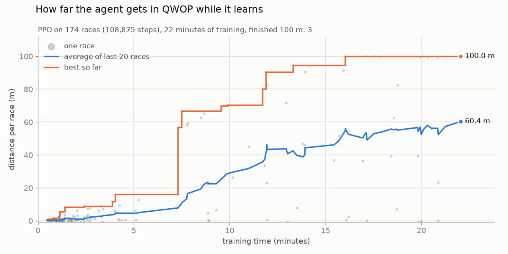
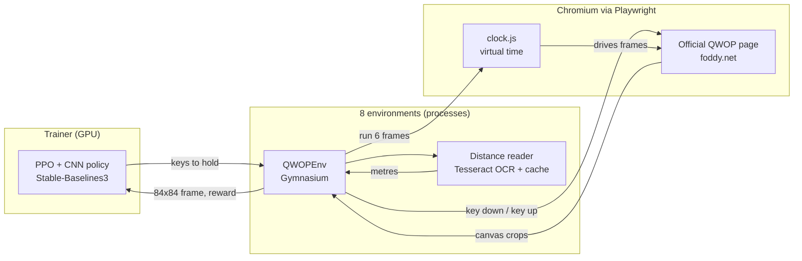

<p align="center">
  
</p>

# Play QWOP with a reinforcement learning agent

[](https://github.com/NatLee/play-qwop-by-using-ai-agent/actions/workflows/ci.yml)
[](https://www.python.org/)
[](https://stable-baselines3.readthedocs.io/)
[](./LICENSE)

[QWOP](https://www.foddy.net/legacy/Athletics.html) is Bennett Foddy's famously awful running game: you get
four keys, Q and W for the thighs and O and P for the calves, and you try to make an Olympic sprinter cover 100
metres without face-planting. This repo teaches a PPO agent to play the **real browser game**: eight headless
Chromium windows load the official page, the agent presses keys through the page, reads the distance off the
canvas with OCR, and learns from it. It finished its first 100 m after about 20 minutes of training.

## Results

<p align="center">
  
</p>

**It finishes.** The trained agent ran the full 100 m in every evaluation race: 3 out of 3 when it always takes
its most likely action (193.8, 200.2 and 210.4 seconds) and 3 out of 3 when it samples actions the way it does
during training (233 to 244 seconds). Its best race took **193.8 seconds**, and the game's own finish screen said
"101 metres in 19.4 seconds" (more on that number below). The GIF above, at 4x speed, is a 200.2-second race.

It does not exactly sprint. It found QWOP's classic knee scoot: one knee on the track, the other leg reaching
forward, shuffle, repeat. That is about 0.5 m/s, but it hardly ever falls, and in QWOP not falling is most of
the battle.

| | 2020 agent (TF2 Actor-Critic) | 2026 agent (PPO, this version) |
| --- | --- | --- |
| Reaches 100 m | yes, one recorded finish | 6 of 6 evaluation races |
| Number on the finish screen | 592.1 | 19.4, 20 and 21 |
| Race time at normal speed | probably about 99 minutes (see below) | 193.8 s best, 200 s typical |
| Training | not recorded | 22 minutes on 8 browsers |

**About the time on the finish screen.** The HTML5 game adds up the race time in seconds but shows
`Math.round(seconds) / 10` on the finish screen, so the number there is a tenth of the real time. This
project runs the game at exactly 60 frames per game second, so 193.8 s is what you would wait watching it at
normal speed. If the 2020 run saw the same screen, its 592.1 means roughly 99 minutes; there is no way to check
that now. To compare with your own best run, compare the numbers on the finish screens: 19.4 is the one to beat.

### From flailing to finishing

<p align="center">
  
</p>

The first 20 seconds of a race. Left: the same training recipe after 5,000 steps (about 2 minutes) drops into a
split at 0.6 m and stays there until the race is cut short. Right: the trained agent is at 9.9 m. The left agent
comes from a separate short run with the same settings and seed, because the main run's first checkpoint
(100,000 steps) was saved after the agent could already run.

### Learning curve

<p align="center">
  
</p>

| Minutes of training | What happened |
| --- | --- |
| 1.4 | best race so far: 8.4 m |
| 4 | 16.2 m |
| 7.3 | first race past 50 m (56.6 m, cut off by the 300 s race limit of that build) |
| 16 | first finish, in 286 s of game time |
| 22 | third finish, in 260 s; training stops by itself (`--stop-after-finishes 3`) |

The run took 22 minutes and 117,608 agent steps (174 races) with 8 browsers sharing 12 CPU threads and the
network on an RTX 4080, at about 90 agent steps (9 seconds of game time) per second. In the last 50 training
races, 10 reached the end of the track and 14 fell within the first 10 m; training samples random actions, so it
falls more often than the evaluation runs above.

Two honest footnotes about that run. It used a slightly earlier build that judged a finish by the score at the
top of the screen (100 m or more) and stopped every race after 300 s. Besides the 3 counted finishes, 7 races
ended between 99.5 and 99.9 m. Those were most likely finishes too (the finish screen can appear before the
score reaches 100), but that build booked them as falls, with a 2-point penalty instead of the 50-point bonus.
And 12 slow races were cut off at 300 s. Both were fixed right after: the end screen now decides, and races may
last 15 minutes. The three races with the most likely actions ran on the fixed version; the three sampled
races ran on an in-between build that ended a race as soon as the score reached 100 m.

## How it works



- **The game.** Every environment opens `https://www.foddy.net/legacy/Athletics.html` once (the old
  `/Athletics.html` address redirects there) and reuses that page for every race. A restart is the R key, not a
  reload. Nothing from the game is stored in this repository.
- **Time is ours.** `qwop_agent/clock.js` replaces the browser's `requestAnimationFrame` and `performance.now()`
  before the page loads. The game only moves when Python asks for frames, so one step is always exactly 6 frames
  (0.1 s of game time), no matter how busy the machine is, and a fast machine plays faster than real time.
  Replaying the same keys gives the same race, frame for frame. Frames between observations skip their WebGL draw
  calls (the physics still runs), which makes stepping about 40% faster without changing the race.
- **Actions.** 9 key combinations: thighs (nothing, Q or W) times calves (nothing, O or P). The keys stay held
  until the agent picks something else.
- **Observation.** A grayscale 84x84 crop around the runner; the trainer stacks the last 4.
- **Reading the distance.** Tesseract reads the "12.3 metres" text at the top. The engine stays loaded
  (tesserocr, about 15 ms per read) and results are cached by the exact pixels, so most steps cost a dictionary
  lookup. A reading that jumps more than 2 m in one step is treated as a misread and ignored.
- **End of a race.** A light grey panel in the middle of the screen means the race is over. The dark bar on that
  panel says "12.3 metres" after a fall and "101 metres in 19.4 seconds" after a finish. The finish screen can show
  up while the score at the top still says 99.x m, so the panel decides.

### Reward shaping

| Term | Value | Why |
| --- | --- | --- |
| Progress | +1 per metre gained, -1 per metre lost | The main signal. Over a race it adds up to the distance. |
| Time | -0.002 per step | Standing still is never free, and faster is better. |
| Fall | -2 once | Falling ends the race. Kept small, or the agent learns to freeze. |
| Finish | +50 once | Reaching 100 m. |

A race is also cut short (without the fall penalty) after 12 s of game time without gaining 0.5 m, or after 15
minutes of game time.

## Install

The Docker image is the easiest way: it has PyTorch with CUDA, Playwright's Chromium and the Tesseract data.

```bash
docker build -t qwop-agent .
docker run --rm qwop-agent --help
```

Without Docker (Python 3.12):

```bash
pip install -e ".[train]"            # add ",dev" for pytest and ruff
playwright install --with-deps chromium
# Tesseract's English data, e.g. "apt install tesseract-ocr-eng" on Debian/Ubuntu,
# then point TESSDATA_PREFIX at the tessdata folder if tesserocr cannot find it.
```

## Quick start

Watch the trained agent run one race and save it as a GIF:

```bash
docker run --rm --shm-size 2g -v "$PWD:/work" -w /work qwop-agent \
  evaluate model/qwop-ppo.zip --gif race.gif
```

```text
race 1: finished 100 m in 200.2 s (finish screen: 20) (reward 145.3)
best: finished 100 m in 200.2 s (finish screen: 20)
GIF saved to race.gif (4.1 MB, 400px, every 4 step(s))
```

Locally you can watch it in a real window at normal speed with
`qwop-agent evaluate model/qwop-ppo.zip --headed --realtime`.

Other commands:

```bash
qwop-agent random --episodes 3                 # random keys: checks the browser and the game work
qwop-agent train --n-envs 8 --max-hours 6      # train; checkpoints and logs go to runs/qwop-ppo
qwop-agent train --resume runs/qwop-ppo/checkpoints/qwop_ppo_100000_steps.zip
qwop-agent compare early.zip trained.zip --gif compare.gif
qwop-agent plot runs/qwop-ppo                  # learning curve PNG
tensorboard --logdir runs/qwop-ppo/logs        # live training curves
```

Training stops by itself once the agent has finished 100 m three times (`--stop-after-finishes`).

The original commands still work and map onto the new ones:

| Old command | Now does |
| --- | --- |
| `python main.py` | `qwop-agent train`, then one race |
| `python main.py --train False --model_path M` | one race with model `M` (default `model/qwop-ppo.zip`) |
| `python main.py --test_env True` | random keys until you stop it |
| `--model_save_path P` | also copies the trained model to `P` |
| `--chrome_driver_path` | accepted and ignored; Playwright brings its own browser |

## Reproduce the results

These are the commands behind the numbers above (Docker, one RTX 4080, 12 CPU threads for the browsers). The
races are deterministic, but PPO with 8 parallel browsers is not bit-for-bit reproducible, so expect the same
ballpark rather than the same seconds.

```bash
docker build -t qwop-agent .
RUN="docker run --rm --gpus all --cpuset-cpus 16-27 --memory 12g --shm-size 3g -v $PWD/runs:/runs -v $PWD:/work -w /work qwop-agent"

# Main run: stopped by itself after 22 minutes (3 finishes)
$RUN train --run-dir /runs/ppo-main --n-envs 8 --max-hours 5.5 --checkpoint-every 100000

# Evaluate, record the best race and export the small policy file shipped in model/
$RUN evaluate /runs/ppo-main/final_model.zip --episodes 3 --export-policy model/qwop-ppo.zip
$RUN evaluate model/qwop-ppo.zip --gif docs/images/best-run.gif --gif-speed 4 \
  --label "PPO after 22 min of training, 4x speed"

# "Early training": a short run with the same settings, checkpoint at 5,000 steps
$RUN train --run-dir /runs/early --n-envs 8 --timesteps 15000 --checkpoint-every 5000 --stop-after-finishes 99
$RUN compare /runs/early/checkpoints/qwop_ppo_5000_steps.zip model/qwop-ppo.zip \
  --labels "5,000 steps (2 min of training)" "118,000 steps (22 min)" --gif docs/images/early-vs-trained.gif

$RUN plot /runs/ppo-main --out docs/images/learning-curve.png
```

`model/qwop-ppo.zip` holds only the policy network (6.9 MB). The full training checkpoints also carry the
optimiser state (21 MB each), which `--resume` needs; they are not in the repository.

## Development

```bash
pip install -e ".[train,dev]" && playwright install --with-deps --only-shell chromium
ruff check . && ruff format --check .
pytest
```

The tests never load the real game. The environment is tested against a fake page and a fake distance reader,
the browser plumbing against a tiny local WebGL page, OCR against rendered text and the original finish
screenshot, and PPO training, checkpoints, GIFs and the learning curve end to end on the fake game.

## Being a good guest on foddy.net

QWOP is © Bennett Foddy. This project plays the official page as a visitor would: each browser loads it once
and reuses it, and nothing from the game is copied into this repository. The GIFs are recordings of the agent
playing. Please keep the number of parallel browsers modest.

## History

The first version (2020) used TensorFlow 2 with an Actor-Critic agent, Selenium with a bundled chromedriver, and
`pynput` pressing keys at the operating system level, so only one game could run at a time and the browser had
to keep focus. It did reach the end of the track, in 592.1 seconds:


The 2026 rewrite keeps the idea (pixels in, keys out, distance as the reward) and replaces everything around it:
PyTorch and Stable-Baselines3 PPO, a Gymnasium environment, Playwright with keys sent to the page, a virtual
clock, several browsers in parallel, checkpoints, TensorBoard and GIF recording.

## References

- [juanto121/qwop-ai](https://github.com/juanto121/qwop-ai) and
  [inoryy/tensorflow2-deep-reinforcement-learning](https://github.com/inoryy/tensorflow2-deep-reinforcement-learning),
  which the 2020 version built on.
- [Stable-Baselines3](https://stable-baselines3.readthedocs.io/), [Gymnasium](https://gymnasium.farama.org/),
  [Playwright for Python](https://playwright.dev/python/), [tesserocr](https://github.com/sirfz/tesserocr).
